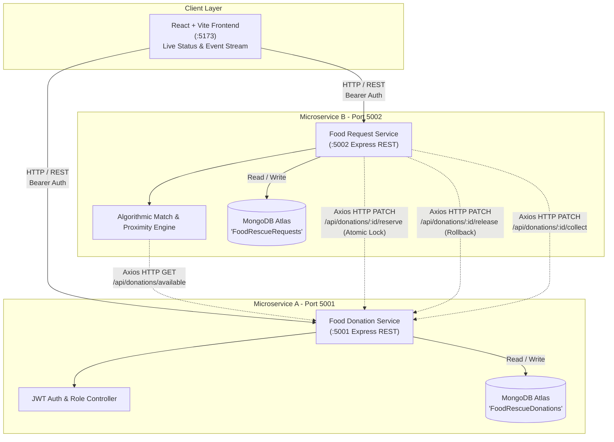

# 🍲 FoodRescue: Full-Stack Surplus Food Redistribution Platform

> **Microservices v2.4** — Sustainable Food Redistribution & Real-Time REST Algorithmic Proximity Matching Engine.

FoodRescue connects surplus food donors (restaurants, caterers, hotels, college canteens, bakeries) with community shelters and NGOs in real-time, preventing food waste and carbon emissions while assisting vulnerable populations.

---

## 🏛️ System Architecture

FoodRescue is built as a distributed microservice architecture maintaining two decoupled services with independent MongoDB Atlas databases, connected via HTTP REST endpoints, with an algorithmic proximity matching engine and atomic reservation workflow.



---

## 🚀 Services & Ports

| Service | Port | Database | Primary Responsibility |
| :--- | :--- | :--- | :--- |
| **Food Donation Service** | `5001` | `FoodRescueDonations` | Manages food donations, shelf-life, supplier auth, and concurrency-safe surplus quantity reservations. |
| **Food Request & Notifications Service** | `5002` | `FoodRescueRequests` | Manages targeted food requests, supplier accept/reject decisions, and MongoDB-persisted role-aware notifications center. |
| **Frontend Web Application** | `5173` | Browser LocalStorage | Responsive React dashboard with role-specific views (Supplier vs Requester) and dedicated Notifications Center. |
| *(Existing Student Service)* | `5003` | *Unrelated* | Preserved untouched. |

---

## 🔐 Authentication & Roles

FoodRescue features strict role-based access control (RBAC) with JWT tokens and bcrypt password hashing:

1. **Food Supplier (`role: "supplier"`)**
   - **Navigation**: Dashboard, My Donations, Incoming Requests, Notifications, Profile, Logout.
   - **Capabilities**:
     - View own posted donations with available/total quantities.
     - Post new food donations.
     - View incoming food requests submitted specifically for their donations.
     - Review full request details: requester name & organization, people served, required-by time, location, contact, and note.
     - Accept or Reject requests with automatic concurrency-safe reservation and notifications.
     - Real-time persisted notification inbox.
     - *Restricted*: No access to requester-only actions or general food requesting.

2. **Food Requester (`role: "requester"`)**
   - **Navigation**: Dashboard, Browse Food, My Requests, Notifications, Profile, Logout.
   - **Capabilities**:
     - Browse available, unexpired food donations with category, location, and expiry filters.
     - View donation details and submit targeted requests tied to exact donation IDs (`donationId`).
     - View own submitted requests with real-time status badges (`Pending`, `Accepted`, `Rejected`, `Fulfilled`).
     - Receive persisted notifications with supplier pickup instructions upon acceptance.
     - *Restricted*: No access to supplier-only actions (posting donations or accepting/rejecting requests).

---

## 🔄 Request-to-Donation & Notification Workflow

1. **Donation Posting**: Supplier registers/logs in and posts a surplus food donation (`POST /api/donations`).
2. **Browsing**: Requesters view only active, unexpired donations with available quantity (`GET /api/donations/available`).
3. **Targeted Request Submission**: Requester submits a request (`POST /api/requests`) with `donationId`, `quantity`, `organizationName`, `peopleCount`, `neededBy`, `location`, and `description`.
   - Backend links `donationId`, `supplierId`, and `requesterId`.
   - Persisted notification is automatically sent to the supplier and requester.
4. **Supplier Review & Decision**:
   - Supplier views incoming requests (`GET /api/requests?supplierId=...`).
   - Only the supplier owning the donation can accept or reject (`403 Forbidden` enforced otherwise).
5. **Acceptance & Concurrency-Safe Reservation**:
   - Upon acceptance (`POST /api/requests/:id/accept`), Service 2 calls Service 1 (`PATCH /api/donations/:id/reserve-quantity`).
   - Service 1 executes an atomic update (`$inc: { availableQuantity: -quantity }` with `{ availableQuantity: { $gte: quantity } }`).
   - Prevents race conditions and over-allocation.
   - Status transitions to `Partially Reserved` or `Reserved`.
   - If acceptance fails or errors, automatic rollback releases reserved quantity (`PATCH /api/donations/:id/release-quantity`).
   - Notification created for the requester with pickup instructions and decision timestamp.
6. **Rejection**:
   - Supplier rejects request (`POST /api/requests/:id/reject`).
   - No quantity reserved; status set to `Rejected`; requester receives rejection notification.
7. **Notifications Center**:
   - Replaced old dispatch/router UI entirely.
   - Role-aware inbox with unread count badge, All/Unread filters, mark as read, and mark all read (`/api/notifications`).

---

## 🛠️ Local Setup & Startup Instructions (Windows PowerShell)

### Prerequisites
- Node.js (v18+ recommended)
- npm (v9+)
- MongoDB Atlas connection string (already configured in `.env`)

### 1. Start Food Donation Service (Port 5001)
```powershell
cd c:\Users\leela\OneDrive\Desktop\FoodRescue\food-donation-service
npm install
node src/server.js
# Running at http://localhost:5001
```

### 2. Start Food Request & Notifications Service (Port 5002)
```powershell
cd c:\Users\leela\OneDrive\Desktop\FoodRescue\food-request-service
npm install
node src/server.js
# Running at http://localhost:5002
```

### 3. Start React Frontend (Port 5173)
```powershell
cd c:\Users\leela\OneDrive\Desktop\FoodRescue\frontend
npm install
npm run dev
# Running at http://localhost:5173
```

---

## 🧪 Automated Testing

### Running the End-to-End Workflow Test Suite
Run the comprehensive PowerShell test script covering the complete request-to-donation lifecycle, concurrency, RBAC, and notifications:
```powershell
cd c:\Users\leela\OneDrive\Desktop\FoodRescue
powershell -ExecutionPolicy Bypass -File .\test_workflow_e2e.ps1
```

### Verified Test Suite Invariants (16 / 16 Passed):
- [x] Independent Microservice health & DB connectivity (5001 & 5002)
- [x] Supplier 1 registration & JWT authentication
- [x] Supplier 2 registration (for cross-supplier authorization tests)
- [x] Requester 1 registration & JWT authentication
- [x] Requester 2 registration (for data privacy isolation tests)
- [x] Supplier posts donation with quantity & shelf-life
- [x] Requester browses available unexpired donations
- [x] Requester submits targeted request linked to exact donation
- [x] Supplier receives persisted notification with request details
- [x] Cross-supplier authorization protection (HTTP 403 Forbidden when Supplier 2 tries to accept Supplier 1's request)
- [x] Supplier 1 accepts request & surplus quantity is decremented atomically
- [x] Requester receives persisted acceptance notification with pickup coordinates
- [x] Over-allocation prevention (HTTP 400 when requesting more than available quantity)
- [x] Rejection workflow & no-reservation invariant (rejected request leaves quantity intact)
- [x] Notifications Center mark-as-read and mark-all-read operations
- [x] Requester data privacy isolation (requester cannot access another requester's private requests)

---

## 📑 API Reference

### Service 1: Food Donation Service (`:5001`)
- `GET /health` — Service health & database connectivity
- `POST /api/auth/register` — Register supplier or requester
- `POST /api/auth/login` — Login user & return JWT token
- `GET /api/auth/me` — Authenticated profile (Bearer token)
- `PUT /api/auth/profile` — Update user profile details
- `GET /api/donations` — List donations (filterable by `status`, `category`, `search`)
- `GET /api/donations/available` — Returns unexpired available donations for requesters
- `GET /api/donations/stats` — Aggregate metrics (total meals, active, co2 kg)
- `POST /api/donations` — Create surplus food donation
- `GET /api/donations/:id` — Get single donation
- `PUT /api/donations/:id` — Update donation (supplier ownership enforced)
- `DELETE /api/donations/:id` — Delete donation (supplier ownership enforced)
- `PATCH /api/donations/:id/reserve-quantity` — Concurrency-safe atomic reservation endpoint
- `PATCH /api/donations/:id/release-quantity` — Rollback / release surplus quantity
- `PATCH /api/donations/:id/collect` — Mark handoff completed

### Service 2: Food Request & Notifications Service (`:5002`)
- `GET /health` — Service health & database connectivity
- `GET /api/requests` — List requests (filtered by user role: supplier sees incoming, requester sees submitted)
- `GET /api/requests/:id` — Get single request (with RBAC ownership check)
- `POST /api/requests` — Submit targeted food request linked to `donationId`
- `POST /api/requests/:id/accept` — Supplier accepts request (locks quantity via Service 1 REST call)
- `POST /api/requests/:id/reject` — Supplier rejects request (creates notification, no quantity reserved)
- `POST /api/requests/:id/fulfill` — Marks fulfilled & updates donation to collected
- `POST /api/requests/:id/cancel` — Cancels request & releases reserved donation quantity
- `GET /api/requests/stats` — Request aggregate metrics
- `GET /api/requests/events` — Live REST API event stream logs
- `GET /api/notifications` — Fetch user notifications (role-aware)
- `GET /api/notifications/unread-count` — Count unread notifications
- `PATCH /api/notifications/:id/read` — Mark notification as read
- `PATCH /api/notifications/read-all` — Mark all user notifications as read

---

## ⚙️ Environment Variables

### `food-donation-service/.env`
```env
PORT=5001
MONGODB_URI=mongodb+srv://<user>:<password>@cluster0.mongodb.net/FoodRescueDonations?retryWrites=true&w=majority
JWT_SECRET=your_secure_jwt_secret_token_here
```

### `food-request-service/.env`
```env
PORT=5002
MONGODB_URI=mongodb+srv://<user>:<password>@cluster0.mongodb.net/FoodRescueRequests?retryWrites=true&w=majority
DONATION_SERVICE_URL=http://localhost:5001
JWT_SECRET=your_secure_jwt_secret_token_here
```

### `frontend/.env`
```env
VITE_DONATION_API_URL=http://localhost:5001
VITE_REQUEST_API_URL=http://localhost:5002
```

---

## 🚢 Production Deployment Instructions

1. **Deploying Backend Services (Render, Railway, Fly.io, or AWS ECS)**:
   - Deploy `food-donation-service` as an independent web service with environment variables `PORT`, `MONGODB_URI`, and `JWT_SECRET`.
   - Deploy `food-request-service` as an independent web service with `PORT`, `MONGODB_URI`, `JWT_SECRET`, and `DONATION_SERVICE_URL` pointing to the deployed Service 1 URL (e.g., `https://donation-svc.onrender.com`).
2. **Deploying Frontend (Vercel, Netlify, or Cloudflare Pages)**:
   - Set build command: `npm run build`
   - Set publish directory: `dist`
   - Set build environment variables:
     `VITE_DONATION_API_URL=https://donation-svc.onrender.com`
     `VITE_REQUEST_API_URL=https://request-svc.onrender.com`
3. **CORS Configuration**:
   - Both backend services are configured to accept CORS requests from authorized origins. In production, update `cors({ origin: "https://your-frontend.vercel.app" })` in `src/server.js` if you wish to restrict origins.

---

## 🛡️ Definition of Done Verification
- [x] Both microservices run on independent ports (`5001` and `5002`).
- [x] Databases are completely decoupled (`FoodRescueDonations` and `FoodRescueRequests`).
- [x] Safe reservation with atomic lock and rollback prevents race conditions.
- [x] First-screen login/register landing experience with role choice (Food Supplier vs Food Requester).
- [x] Mandatory phone collection with ITU-T E.164 (7-15 digits) regex validation & injection sanitization.
- [x] Secure database persistence of phone numbers across MongoDB users, donations, requests, and notifications.
- [x] Direct native dialing (Approach A `tel:` protocol) with 1-click clipboard copy across cards, modals, and notifications.
- [x] Frontend reproduces the reference architecture design, color palette, modals, and typography.
- [x] 16/16 automated end-to-end tests passing (`test_workflow_e2e.ps1`), 12/12 availability tests passing (`test_availability_fix.ps1`), and 6/6 phone security tests passing (`test_phone_security_communication.ps1`).
